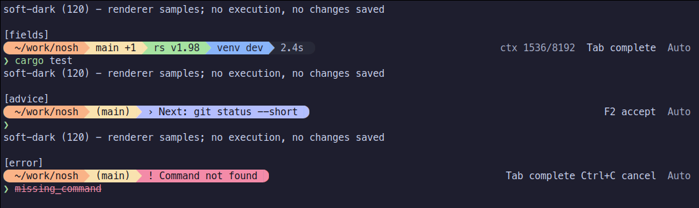
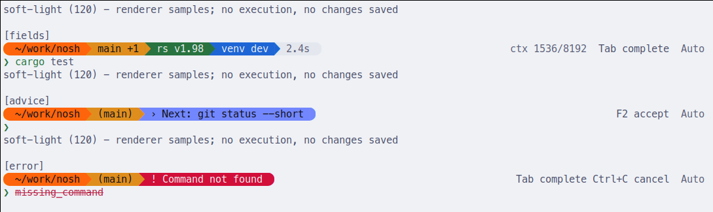

# Shell 主题与 Starship

nosh 内建 `soft-dark`（默认）和 `soft-light`，以 Catppuccin Mocha / Latte 配色统一提示符、状态行、输入高亮、补全/历史以及 AI/审批正文。左侧环境、命令结果和当前状态按内容宽度连续分段着色，块间不露出终端底色；右侧上下文用量、操作与模式只绘制文字，左右空区不铺底色。自定义主题直接使用 **当前官方 Starship TOML schema**，由官方 CLI 解析；不维护私有配色协议或旧版迁移层，也不依赖 Starship 的内部 Rust API。

内建主题不需要 Starship。读取外部主题或启用环境模块时，`starship` 必须在 PATH 中；缺失或执行失败会明确报告，不自动安装。默认自动选择 Powerline：确认宿主可绘制分隔字形时启用，否则使用紧凑、无描边矩形色块。不要求安装 Nerd Font，也不修改终端的全局背景。

## 使用

在 nosh 提示符内，`#theme` 查看当前主题，指定名称或文件路径时切换：

```text
#theme
#theme soft-light
#theme "./my theme.toml"
```

命令跟随配置的 `ai_prefix`。启用补全时，输入 `#theme ` 自动展示内建主题，标记当前项；用方向键/Tab 选择，Enter 回填，再次 Enter 才保存并切换。Esc 关闭并保留草稿，可继续输入文件路径；补全不请求模型，完整规则见[本地补全](COMPLETION.md)。路径可用引号或反斜杠引用空格，不执行变量或命令替换。关闭 AI 或清空前缀时，改用独立 CLI：

```bash
nosh theme list
nosh theme preview soft-light
nosh theme set soft-light

# 导出标准 Starship 配置，不需要安装 Starship。
nosh theme export soft-dark > my-starship.toml
nosh theme preview ./my-starship.toml
nosh theme set ./my-starship.toml
```

`#theme <名称或路径>` 与 `nosh theme set` 共用校验和保存逻辑。**保存后无需重启**：在 nosh 中执行切换命令后，新主题会用于接下来的命令输入界面。其他使用同一配置文件的 nosh 窗口不会立即重绘；它们在当前命令执行结束后更新，空闲时可在空白输入行按 Enter 刷新。不会打断正在编辑的草稿、搜索、菜单或前台程序。

保存失败不切换。无参数 `#theme`、`list`、`preview` 和 `export` 不写配置；独立 CLI 在 AI 禁用时仍可使用。

`preview` 支持 `--columns 17..4096`、`--mode auto|confirm|yolo|off`、`--nerd-font`，以及 `--case idle|input|fields|pending|advice|error|unavailable|completion|history`。默认沿用配置的自动/显式字形选择，`--nerd-font` 仅在本次预览中强制请求 Powerline；输出能力仍优先。`fields` 展示多分区示例；所有样本都是固定展示数据，不代表当前机器或真实模型用量，不执行样本命令或环境查询。外部文件只调用静态样式解析。具名 `export soft-dark|soft-light` 保持不依赖当前终端的确定性输出，需要 Powerline 时加 `--nerd-font`。

```toml
[shell]
theme = "soft-dark" # soft-dark | soft-light | Starship TOML 路径
starship = false   # 可选：复用 Starship 环境模块
nerd_font = "auto" # 默认；也可用 true 显式启用、false 关闭
```

配置路径沿用[系统配置](DESIGN.md#11-配置)，包括 `NOSH_HOME`。配置文件中的相对主题路径相对于配置目录；命令中的相对路径使用当前工作目录（inline 命令遵循 shell 中的 `cd`），保存时写入解析后的绝对路径。仅重载主题和上述显示选项，不同时热加载安全、模型或键位配置。

## 按需出现的字段

| 分区 | 字段与出现条件 |
|---|---|
| 目录 / Git | 默认提供 cwd、分支；启用 Starship 后增加未提交、暂存、未跟踪及 ahead/behind 状态 |
| 运行时 / 虚拟环境 | `starship = true` 时由官方模块检测 Rust、Node.js、Go、Python，以及活动 Python / Conda 环境；不相关或未知的字段不占位 |
| 上次命令 | 真实用户命令的非零退出码，或至少 2 秒的耗时；快速成功不常驻 `exit 0`，取消输入不伪造执行记录 |
| 当前状态 | 输入诊断、菜单/搜索、实际排入的 AI Next/Fix 生成状态与可采用候选；没有候选时不显示 F2 采用 |
| AI 上下文 | 已有 Agent 对话的 `ctx 已用/上限`，空间不足时缩为百分比，达到 85% 用警告色；无对话/AI 关闭时隐藏，不为展示加载模型 |
| 操作 / 模式 | 当前有效键、实际审批/编辑模式；始终让位于必要原因和退出/采用操作 |

上下文用量与 `#ctx` 使用同一份对话统计，不混入后台建议临时会话；后台持有引擎时读取已有快照，不等待或打断推理。前台 Agent 执行和审批仍使用原正文界面，不把旧提示符变为全局任务栏。

## 兼容范围

原生文件使用 Starship 的 [`palette` / `palettes`、`format` 和模块配置](https://starship.rs/config/)。内建目录和 Git 分段分别读取 `directory.style`、`git_branch.style`；其它实时区域用标准 `custom` 表中的静态 `nosh_*` 样式映射：

```toml
"$schema" = "https://starship.rs/config-schema.json"
palette = "my_palette"
format = "$directory$git_branch$rust$nodejs"

[palettes.my_palette]
text = "#CDD6F4"
surface = "#242433"
blue = "#89B4FA"

[directory]
style = "fg:blue bg:surface"

[custom.nosh_operation]
disabled = true
style = "bold fg:blue"
```

`custom.nosh_<role>.style` 的颜色引用、`fg:` / `bg:` 和属性由 Starship 解释。`disabled = true` 不妨碍 nosh 读取静态样式，同时确保 Starship 不把它当成可执行模块。省略的角色继承内建缺省值；未知的保留角色会报错。

| 角色 | 含义 |
|---|---|
| `environment`、`git_branch`、`status` | 目录、Git 与中性状态分段 |
| `operation`、`mode` | 右侧操作与模式文字；只绘制前景 |
| `advice`、`pending`、`notice`、`failure` | 建议、查询、不确定/不可用、错误 |
| `selection` | 补全选中项 |
| `text`、`muted`、`accent`、`positive`、`warning`、`error`、`keyword`、`string` | 输入及正文语义文字；只绘制前景 |

RGB 和 256 色后备自动解析/生成，用户不必手写索引。映射到 nosh 语义角色的 RGB 与后备色对比度都至少为 4.5:1；支持粗体、斜体、下划线和删除线，反色归一化为交换前景/背景。低对比、dim、hidden、blink 和无法解析的样式明确拒绝，不悄悄改成正常外观。普通文字、操作与模式不绘制背景，样式须继承明暗主题的参考背景，不能依赖另一个不被绘制的底色通过对比度检查。原生模块片段保留上游样式，不代表其中任意配色或宿主实际像素都通过了此对比度检查。

静态解析只向 Starship 提交颜色和样式探针，**不执行主题里的自定义命令**。未禁用的 `custom.*.command` 或字符串 `when` 会拒绝导入。文件上限 256 KiB。通用 Starship 模板的布局、条件和脚本并非 nosh 的完整兼容承诺。

## 环境模块与 Powerline

`starship = true` 在新一轮命令输入前调用 Starship，复用 cwd、Git、语言版本等模块和当前 shell 的导出环境，并传入真实用户命令的退出码和毫秒耗时。内建导出包含 `git_status`、`rust`、`nodejs`、`golang`、`python`、`conda`、`status` 和 `cmd_duration`。`format` 控制左侧片段及其中的结果/耗时，不再额外包裹底色、重复加端点或重复显示 nosh 的结果块；自定义原生主题可通过这些模块的 `disabled` / `format` 配置取舍字段。nosh 仍管理独立输入行、实时诊断、上下文与审批状态。自定义 PS1 优先，不再叠加 Starship 环境。

内建 Powerline 导出使用官方 `prev_bg` 连接实际出现的模块，缺失模块不留下空过渡，整段只保留一对外侧圆头。原生片段后接 nosh 实时状态时，只把可识别且未裁剪的末端圆头衔接到下一块背景；用户模板内部的布局、字面字符和有意留白仍保留，不批量删除空格或私有区字符。

结果缓存为只含文字与 SGR 的片段，保留模板有意设置的首尾留白。解码时计算显示宽度，重绘按字素裁剪已有前缀，省略号继承末段样式，不额外展开或复制整段文本。输入、异步反馈、补全/历史导航和缩放不重跑模块；首屏复用启动时已校验的主题，主题来源和内容未变时不重复解析静态样式，无关配置修改也不触发解析。每次调用没有 stdin 或控制终端，最多 2 秒、每个输出流最多 64 KiB；失败/取消收回进程组并报告，环境生成失败时仍可使用原生 cwd/Git 提示。这不是程序沙箱，启用环境模块会运行其原有版本/状态查询。

`nerd_font` 省略时等同于 `"auto"`；`true` 显式声明字形支持，`false` 关闭。自动模式只识别已核实的内建 Powerline 渲染：

| 宿主条件 | 自动选择 |
|---|---|
| 直连 Kitty：`TERM=xterm-kitty`，且 `KITTY_WINDOW_ID` 是有效正整数 | 启用圆头/楔形 |
| 直连 Ghostty：`TERM=xterm-ghostty` 且 `TERM_PROGRAM=ghostty` | 启用圆头/楔形 |
| SSH，或存在 tmux / screen / Zellij 标记 | 不沿用可能继承的宿主线索，回退矩形 |
| 其它/未知宿主、仅有 `xterm-256color`、`WT_SESSION` 或 VS Code 名称 | 无法确认实际渲染设置，回退矩形；支持字形时可显式开启 |

自动模式还要求彩色 Unicode TTY 和已确认的扩展色支持。判断只读启动环境并缓存，不发送字体查询/试画字符，不读取终端配置，也不扫描本机字体；不把宿主名称或 UTF-8 单独当作字体证明。依据是 [Kitty 的内建字形路径](https://github.com/kovidgoyal/kitty/blob/42eb2a1c3b948a5bdbd23b793e03817697ed2ae8/kitty/fonts.c#L812-L850) 和 [Ghostty 的 Powerline 绘制实现](https://github.com/ghostty-org/ghostty/blob/1da3ac43bef626ec1155c366c1960cb0f4f74d1f/src/font/sprite/draw/powerline.zig)；这不是对所有宿主或字体配置的通用认证。

自动确认 Powerline **不等于确认全部 Nerd Font 图标**：原生配置的格式、符号及符号/替换映射中只放行已支持的基本分隔符 `U+E0B0..U+E0B7`，包括电量分档、Kubernetes 上下文等表数组中的符号；其它私有区图标仍需 `nerd_font = true`，检测路径和映射键不改写。也可先执行 `nosh theme preview --nerd-font` 验证外观。内建分段只在整条左侧内容的首尾绘制圆头，内部使用连续楔形，不为每个信息组单独包圆头。

所有字形均计入内容预算；显式开启也不绕过无色/ASCII 回退，内建端点退为空格，有颜色时内部空格不打断背景。原生片段在无色、ASCII 或没有扩展色能力时也去掉格式和符号里的私有区字形。不探测或修改宿主字体。

以下为原生 xterm + MesloLGS NF、显式启用 Powerline 的代表性截图；当前配置的自动/显式外观可通过 `nosh theme preview` 直接查看：





## 边界与维护

- `NO_COLOR` / `CLICOLOR=0` 和终端能力优先于主题；无色仍保留原因和真实键名。用户命令输出、管道和 JSON 不添加主题装饰。
- 保存只修改主题选择，保留注释、安全规则和其它键。通过同目录临时文件、同步和原子替换提交；只读、非法 TOML、可检测的并发修改、符号链接/非本人所有/多硬链接配置均拒绝写回。
- 启动时无效主题会警告并回退内建默认，不写回；运行期无效配置保留最后有效主题，重复错误去重。
- 自适应预算、安全末列、自定义 PS1/PS2 和前台所有权约定见[状态行说明](STATUS-BAR.md)。未覆盖宿主、透明主题和既有 tmux 历史草稿残留不因配色更新被视为已解决。

实现分工：`nosh-cli/src/starship.rs` 适配官方 CLI，`config/theme.rs` 管理选择与保存，`nosh-shell/src/theme.rs` 提供语义样式。`ThemeHandle` 与现有 editor 共用重绘入口；嵌入宿主把同一句柄传给 `ReplConfig.status_bar.theme`、`ShellAi::with_theme`、`TermUi::with_theme` 和 `TerminalApproval::detect_with_theme`。`ReplConfig.theme_command` 提供查询/持久化入口，`theme_loader` 在提示符边界应用结果；未提供选择入口的宿主会明确提示不可用。

核心回归使用现有 shell、CLI 和终端测试；安装 Starship 后可显式运行官方引擎集成用例：

```bash
cargo test -p nosh-cli --bin nosh --test theme --locked -- --include-ignored
cargo test -p nosh-shell --lib --locked
cargo test -p nosh-core --test terminal --locked
```
